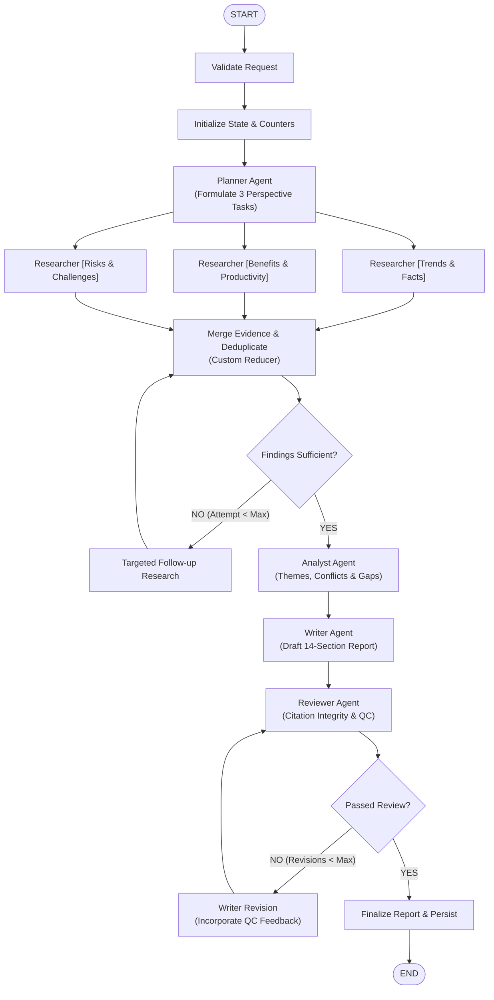

# ResearchLab AI - Autonomous Multi-Agent Research System

[](https://www.python.org/)
[](https://fastapi.tiangolo.com)
[](https://github.com/langchain-ai/langgraph)
[](https://react.dev/)
[](https://tailwindcss.com/)
[](https://opensource.org/licenses/MIT)

An end-to-end autonomous research application where multiple specialized AI agents collaborate using **LangGraph** to formulate plans, gather web evidence in parallel, cross-examine claims, draft comprehensive 14-section research reports, and verify citation integrity with bounded revision loops.

Built **free-first** using local **Ollama** models by default (with optional Google Gemini and Groq free tiers), no paid APIs required.

---

## 📸 Interface Preview

```
┌─────────────────────────────────────────────────────────────────────────────────┐
│  ResearchLab AI                   [OLLAMA: llama3.2 ●] [SEARCH: duckduckgo] ☼  │
├───────────────┬─────────────────────────────────────────────────────────────────┤
│ ＋ New Search │  What would you like to investigate?                            │
│ ◷ History     │  ┌───────────────────────────────────────────────────────────┐  │
│ ⚙ Settings    │  │ Analyze the impact of generative AI on software           │  │
│               │  │ development, including productivity, employment,          │  │
│               │  │ risks, limitations, and future trends.                    │  │
│               │  └───────────────────────────────────────────────────────────┘  │
│               │  [Quick Brief]  [Standard (Recommended)]  [Comprehensive]       │
│               │  [ Start Autonomous Research -> ]                               │
│               │                                                                 │
│               │  Live Workflow Progress (SSE Streaming):                        │
│               │  ✔ Planner Agent: Formulated 3 perspective tasks                │
│               │  ✔ Researcher [Trends]: 4 verified sources collected            │
│               │  ✔ Researcher [Benefits]: 3 empirical studies extracted         │
│               │  ✔ Researcher [Risks]: 4 security & limitation vectors          │
│               │  ✔ Evidence Validation & Deduplication                          │
│               │  ✔ Analyst Agent: Cross-examined claims & detected conflicts    │
│               │  ✔ Writer Agent: Drafted 14-section research report             │
│               │  ✔ Reviewer Agent: QC citation integrity approved [Passed]      │
│               │  [Export PDF]  [Download .MD]  [Copy Markdown]                  │
└───────────────┴─────────────────────────────────────────────────────────────────┘
```

---

## 🌟 Key Features

- **Stateful Multi-Agent Orchestration:** Real LangGraph execution graph with parallel execution branches, typed state, and persistent checkpointers.
- **5 Specialized AI Agents:**
  1. **Planner Agent:** Strategic question decomposition and query generation.
  2. **Researcher Agents (3x Parallel):** Concurrently investigate **Trends & Facts**, **Benefits & Velocity**, and **Risks & Limitations**.
  3. **Analyst Agent:** Cross-examines findings, clusters recurring themes, identifies contradictions, and evaluates research sufficiency.
  4. **Writer Agent:** Drafts an exhaustive 14-section research report with grounded inline citations `[1]`, `[2]` linked to real sources.
  5. **Reviewer Agent:** Deterministic and LLM quality checks with bounded revision loops (max 2 revisions).
- **Free-First AI Architecture:**
  - **Default:** Runs 100% locally and privately with **Ollama** (`llama3.2`, `mistral`, or `phi3`).
  - **Optional Free-Tier APIs:** Configurable for Google Gemini or Groq free tiers.
  - **Deterministic Mock Mode:** Zero-cost offline testing fallback.
- **Real Web Search & Evidence Collection:**
  - **DuckDuckGo Search:** Free, no-key web search.
  - **Safe Page Reader:** HTTPX and BeautifulSoup parser with content sanitization.
  - **SSRF Protection:** Strict IP blocking for localhost, loopback, private subnets (RFC 1918), and internal networks.
- **Real-Time Progress Streaming:** Server-Sent Events (SSE) stream backend node updates directly to the React interface with zero artificial delays.
- **Persistent Database:** SQLite (default local) or PostgreSQL with SQLAlchemy 2.0 and Alembic migrations.
- **Professional PDF & Markdown Export:** Clean ReportLab PDF generator with custom styling, headers, and clickable links.

---

## 🏗️ System Architecture



---

## 📁 Project Directory Structure

```
Langgraph/
├── frontend/                         # Modern React + TypeScript + Vite UI
│   ├── src/
│   │   ├── components/
│   │   │   ├── Navbar.tsx            # Header, model badges & dark mode
│   │   │   ├── Sidebar.tsx           # Navigation & active agent breakdown
│   │   │   ├── ResearchForm.tsx      # Interactive topic input & depth cards
│   │   │   ├── ProgressTracker.tsx   # 10-stage real-time SSE progress tracker
│   │   │   ├── ReportViewer.tsx      # Markdown renderer, citations & exports
│   │   │   └── SourcesPanel.tsx      # Grounded web source inspection cards
│   │   ├── pages/
│   │   │   ├── WorkspacePage.tsx     # Main research orchestrator
│   │   │   ├── HistoryPage.tsx       # Research session archives & deletion
│   │   │   └── SettingsPage.tsx      # Provider health & Ollama setup guide
│   │   ├── services/
│   │   │   └── api.ts                # Fetch client & SSE event endpoints
│   │   ├── types/                    # TypeScript interfaces
│   │   ├── App.tsx                   # React Router layout
│   │   └── main.tsx
│   ├── package.json
│   ├── vite.config.ts
│   └── tailwind.config.js
├── backend/                          # FastAPI + LangGraph Backend
│   ├── app/
│   │   ├── agents/                   # 5 Specialized AI Agents
│   │   │   ├── planner.py            # PlannerAgent
│   │   │   ├── researcher.py         # ResearcherAgent
│   │   │   ├── analyst.py            # AnalystAgent
│   │   │   ├── writer.py             # WriterAgent
│   │   │   └── reviewer.py           # ReviewerAgent
│   │   ├── graph/                    # LangGraph Orchestration
│   │   │   ├── state.py              # TypedDict state & custom reducers
│   │   │   ├── nodes.py              # Sequential & parallel nodes
│   │   │   ├── routing.py            # Sufficiency & review conditional routers
│   │   │   └── builder.py            # StateGraph compilation
│   │   ├── tools/                    # Web tools & LLM provider abstraction
│   │   │   ├── source_validator.py   # SSRF defense & content sanitization
│   │   │   ├── page_reader.py        # HTTPX + BeautifulSoup scraper
│   │   │   ├── web_search.py         # DuckDuckGo & Tavily provider
│   │   │   └── llm_provider.py       # Ollama, Gemini, Groq & Mock factory
│   │   ├── database/                 # SQLAlchemy persistence & Alembic
│   │   │   ├── models.py             # Sessions, Tasks, Sources, Reports
│   │   │   ├── repository.py         # CRUD repository
│   │   │   └── checkpointing.py      # LangGraph checkpointer
│   │   ├── services/                 # Services & Exporters
│   │   │   ├── event_broadcaster.py  # Asynchronous SSE broadcaster
│   │   │   ├── pdf_exporter.py       # ReportLab PDF generator
│   │   │   └── research_service.py   # Session & worker coordinator
│   │   ├── workers/
│   │   │   └── research_worker.py    # Background LangGraph execution
│   │   ├── api/                      # Versioned FastAPI routes & schemas
│   │   ├── config.py                 # Pydantic Settings
│   │   └── main.py                   # FastAPI entrypoint
│   ├── migrations/                   # Alembic database migration scripts
│   ├── tests/                        # 23 Automated pytest test suites
│   ├── requirements.txt
│   └── pytest.ini
├── docs/                             # In-Depth Documentation
│   ├── ARCHITECTURE.md               # Beginner's guide to LLMs, LangGraph & Agents
│   ├── SETUP.md                      # Windows PowerShell step-by-step setup
│   ├── API.md                        # Full REST API & SSE protocol specification
│   └── DEPLOYMENT.md                 # Docker Compose & production deployment
├── docker-compose.yml                # Multi-container deployment configuration
├── .env.example                      # Safe environment template
├── .gitignore
└── README.md
```

---

## ⚡ Quickstart Guide (Windows PowerShell)

### 1. Prerequisites
- **Python 3.11+** installed
- **Node.js (v18+)** installed
- **Ollama** installed with `ollama pull llama3.2`

### 2. Configure Environment
```powershell
Copy-Item .env.example .env
```

### 3. Backend Setup
In your first terminal:
```powershell
cd backend
python -m venv venv
.\venv\Scripts\Activate.ps1
pip install -r requirements.txt
alembic upgrade head
uvicorn app.main:app --host 127.0.0.1 --port 8000 --reload
```

### 4. Frontend Setup
In a second terminal:
```powershell
cd frontend
npm install
npm run dev
```

Open **`http://localhost:5173`** in your browser to start your first research session!

---

## 🧪 Automated Testing

### Backend Unit & Integration Tests (pytest)
```powershell
cd backend
.\venv\Scripts\pytest -v
```

**Verified Test Suite Results (23 Passed):**
```
tests/test_agents.py::test_planner_output_schema PASSED
tests/test_agents.py::test_researcher_output_schema PASSED
tests/test_agents.py::test_analyst_agent_evaluation PASSED
tests/test_agents.py::test_writer_and_reviewer_flow PASSED
tests/test_agents.py::test_reviewer_bounded_revision_limit PASSED
tests/test_api.py::test_health_endpoint PASSED
tests/test_api.py::test_config_endpoint PASSED
tests/test_api.py::test_providers_endpoint PASSED
tests/test_api.py::test_create_research_validation PASSED
tests/test_api.py::test_create_and_manage_research PASSED
tests/test_e2e.py::test_full_workflow_end_to_end PASSED
tests/test_graph.py::test_source_deduplication_reducer PASSED
tests/test_graph.py::test_findings_reducer_deduplication PASSED
tests/test_graph.py::test_route_sufficiency PASSED
tests/test_graph.py::test_route_review PASSED
tests/test_graph.py::test_checkpointing_configuration PASSED
tests/test_repository.py::test_repository_crud PASSED
tests/test_tools.py::test_ssrf_protection_blocked_ips PASSED
tests/test_tools.py::test_ssrf_protection_safe_urls PASSED
tests/test_tools.py::test_content_sanitization_prompt_injection PASSED
tests/test_tools.py::test_content_sanitization_truncation PASSED
tests/test_tools.py::test_search_provider_mock PASSED
tests/test_tools.py::test_llm_provider_mock PASSED
============================= 23 passed in 9.24s ==============================
```

### Frontend Component Tests (Vitest)
```powershell
cd frontend
npm test
```

**Verified Test Results (5 Passed):**
```
 ✓ src/tests/ResearchForm.test.tsx  (3 tests)
 ✓ src/tests/ReportViewer.test.tsx  (2 tests)
 Test Files  2 passed (2)
      Tests  5 passed (5)
```

---

## 📄 License
This project is licensed under the MIT License.
"# Langgraph" 
