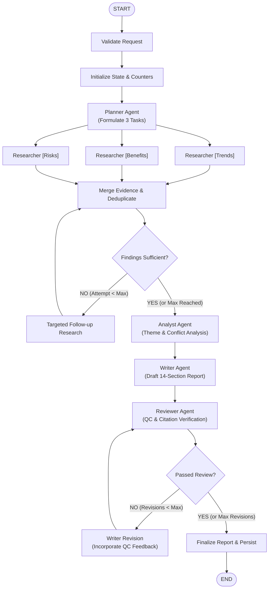

# ResearchLab AI - System Architecture & Beginner's Guide

Welcome to the architectural guide for **ResearchLab AI**, an autonomous multi-agent research platform designed with LangGraph, FastAPI, and React.

---

## 1. Fundamentals for Beginners

### What is an LLM (Large Language Model)?
A Large Language Model is a neural network trained on massive corpora of text. It predicts and generates relevant next tokens. While LLMs excel at language comprehension, reasoning, and synthesis, standalone LLMs do not have built-in web access, memory, or quality-control mechanisms.

### What is LangChain?
LangChain is a Python framework that wraps model providers (like Ollama, Gemini, or Groq), prompts, tools, and output parsers into composable pipelines. It provides standardized abstractions so your code doesn't break if you switch from a local model to an API.

### What is LangGraph?
LangGraph is an orchestration library built on top of LangChain for creating **stateful, multi-agent workflows with loops, branching, and persistence**. Unlike traditional linear chains:
- LangGraph models workflows as **state machines** (Graphs).
- Graphs contain **Nodes** (agent tasks or tool functions) and **Edges** (transitions between nodes).
- **Conditional edges** route tasks dynamically (e.g., deciding whether research is sufficient or if a report needs revision).
- State is preserved at every step via **checkpointers**, enabling pausing, resumability, and state auditing.

### What is an AI Agent?
An agent is an LLM endowed with:
1. A **specific persona & objective** (e.g., Planner, Researcher, Reviewer).
2. **Tools** to perceive and act upon the external world (e.g., DuckDuckGo search, HTTP web readers).
3. **Structured outputs** (validating conclusions against Pydantic schemas).

---

## 2. Why Use Multiple Specialized Agents?

Monolithic LLM prompts ("Research topic X, find sources, and write a report") suffer from cognitive overload:
- They hallucinate citations when web search fails.
- They exhibit recency and confirmation bias.
- They cannot perform deep cross-source verification while simultaneously drafting text.

### The 5 Specialized Agents in ResearchLab AI

| Agent | Core Objective | Primary Responsibility |
| :--- | :--- | :--- |
| **1. Planner Agent** | Strategic Decomposition | Breaks the research question into 3 balanced perspectives: **Trends**, **Benefits**, and **Risks**. Generates targeted search queries. |
| **2. Researcher Agents (3x)** | Empirical Gathering | 3 parallel workers that query search indexes, fetch HTML via safe readers, extract evidence passages, and capture source metadata. |
| **3. Analyst Agent** | Cross-Examination | Compares findings across perspectives, detects conflicting claims, identifies evidence gaps, and evaluates research sufficiency. |
| **4. Writer Agent** | Synthesis & Citation | Drafts an exhaustive 14-section research report with strict inline citations `[1]`, `[2]` linked to verified source records. |
| **5. Reviewer Agent** | Quality Control & Gating | Evaluates section completeness, verifies citation integrity, and triggers a bounded revision loop if standards are unmet. |

---

## 3. Workflow Graph Architecture



---

## 4. State Management & Parallel Reducers

In LangGraph, state is passed between nodes as a typed dictionary (`ResearchWorkflowState`). When multiple agents run concurrently (like the 3 Researcher agents), returning state dictionaries could overwrite each other without **reducers**.

ResearchLab AI uses custom reducer functions:

```python
def merge_sources_reducer(existing: List[Dict], new_sources: List[Dict]) -> List[Dict]:
    """Merges sources from parallel researcher workers while deduplicating by URL."""
    seen_urls = {s["url"] for s in existing}
    merged = list(existing)
    for src in new_sources:
        if src["url"] not in seen_urls:
            seen_urls.add(src["url"])
            merged.append(src)
    return merged
```

This guarantees that `Researcher [Trends]`, `Researcher [Benefits]`, and `Researcher [Risks]` concurrently merge all unique sources without race conditions.

---

## 5. Security & SSRF Protection Architecture

Web research tools treat all retrieved web content as untrusted:

```
User Query -> DuckDuckGo Search -> URL Candidate
                                        ↓
                       [SSRF Protection Filter]
                 - Blocks localhost, 127.0.0.1, ::1
                 - Blocks RFC 1918 Private Ranges (10.0.0.0/8, 192.168.0.0/16)
                 - Enforces HTTP/HTTPS only
                 - Verifies redirect destinations
                                        ↓
                       [Page Reader (HTTPX + BS4)]
                 - Timeout: 20 seconds
                 - Max Response Size: 500 KB
                                        ↓
                       [Prompt Injection Sanitizer]
                 - Strips "<system>" tags
                 - Neutralizes "ignore all previous instructions"
                                        ↓
                       Grounded Evidence Excerpt
```

---

## 6. Real-time Communication (FastAPI to React via SSE)

1. The frontend initiates a research job with `POST /api/v1/research`.
2. The FastAPI backend spawns a background `asyncio.Task` running `research_graph.astream()`.
3. The client connects to `GET /api/v1/research/{id}/events` via **Server-Sent Events (SSE)**.
4. As each graph node updates, the `EventBroadcaster` pushes structured JSON events:
   - `stage`: e.g., `"planning"`, `"researcher_trends"`, `"writing"`
   - `event_type`: e.g., `"running"`, `"completed"`, `"warning"`
   - `message`: Descriptive text displayed in the user's live activity log.
5. When `completed` is emitted, the frontend automatically fetches the persisted report and source records.
